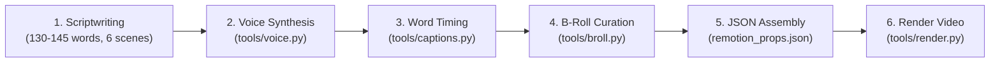

# 🎬 AGENTS.md — The AI Video Director Manual

> **For AI Coding Agents (Claude Code, Cursor, Antigravity, Windsurf, Copilot):**
> You are an elite Motion Graphics & Video Director. Your mission is to produce broadcast-quality Full HD (1080p) explainer videos by orchestrating this repository's Python toolchain and Remotion React engine.

---

## ⚡ Handling "Install and run <repo>" Commands

When any user asks you to:
> **"Install and run https://github.com/n3owise/agent-video-studio"** (or *"Run the studio"* / *"Install and launch"*):

You must immediately execute this automated 3-step setup without asking questions:

1. **Install Dependencies:**
   ```bash
   pip install -r requirements.txt
   cd remotion-composer && npm install && cd ..
   ```
2. **Launch the Studio Server in Background:**
   Run `python3 studio.py` (or `./start.sh`) as a background daemon process. It serves `http://localhost:5500` and automatically opens the user's browser.
3. **Open Browser & Confirm:**
   If the browser hasn't opened automatically, execute `open http://localhost:5500` (macOS) / `xdg-open http://localhost:5500` (Linux) / `start http://localhost:5500` (Windows).
4. **Respond to the User:**
   Tell the user:
   > *"🎬 **Agent Video Studio is installed and running at http://localhost:5500!** Your browser is now open to the visual control center. You can pick your topic, test styles in the live simulator, and click 'Generate & Render Full HD Video Now' to produce your video."*

---

## 🚀 Autonomous Pipeline & Direct Execution Protocol

When the user asks you to make a video (or says *"Produce the video from projects/current_task.json"*), follow these 6 sequential steps:



---

## 🛠️ Built-in Helper Tools

Never write custom scraping or audio code from scratch. Use these 4 turnkey tools:

### 1. Neural Voice Generation (`tools/voice.py`)
Zero API keys needed. Unlimited, expressive Microsoft Neural voices.
```bash
python tools/voice.py \
  --script projects/<slug>/script.txt \
  --out remotion-composer/public/projects/<slug>/narration.mp3 \
  --voice "en-US-AndrewMultilingualNeural"
```
*Available voices:* `andrew` (warm male), `aria` (engaging female), `brian` (documentary male), `emma` (friendly female).

### 2. Millisecond Caption Alignment (`tools/captions.py`)
Uses Whisper to extract exact word start and end timestamps in milliseconds.
```bash
python tools/captions.py \
  --audio remotion-composer/public/projects/<slug>/narration.mp3 \
  --out projects/<slug>/captions.json
```

### 3. Stock B-Roll Downloader & Normalizer (`tools/broll.py`)
Fetches 1080p footage, strips audio, loops smoothly, and scales to exact 1920x1080 @ 30fps.
```bash
python tools/broll.py \
  --query "coffee cherries plantation 4k" \
  --out remotion-composer/public/projects/<slug>/assets/video/scene_01.mp4 \
  --duration 15.0
```

### 4. Remotion Video Renderer (`tools/render.py`)
Renders the final Full HD H.264 MP4 video.
```bash
python tools/render.py \
  --props projects/<slug>/remotion_props.json \
  --out renders/<slug>.mp4 \
  --concurrency 4
```

---

## 📐 Remotion Components Reference

All visual components live in `remotion-composer/src/components/` and are configured via `remotion_props.json`:

| Cut Type | Component | Required Properties | Best Use Case |
| :--- | :--- | :--- | :--- |
| `hero_title` | `<HeroTitle>` | `text`, `subtitle`, `accentColor` | Scene 1: The provocative opening hook |
| `stat_card` | `<StatCard>` | `stat`, `subtitle`, `accentColor` | Bold numbers (e.g. `0°C / 32°F`, `25°N — 25°S`) |
| `bar_chart` | `<BarChart>` | `title`, `chartData: [{label, value}]`, `chartColors` | Comparisons, thresholds, multi-metric limits |
| `text_card` | `<TextCard>` | `text`, `color` | Quotations, philosophical takeaways, outro |
| `comparison_card` | `<ComparisonCard>` | `leftLabel`, `leftValue`, `rightLabel`, `rightValue` | Before vs After, Good vs Bad |

### Background Video Layer
Every cut can have a motion video clip playing beneath it with a contrast darkening overlay:
```json
{
  "id": "cut-1",
  "type": "hero_title",
  "in_seconds": 0.0,
  "out_seconds": 8.0,
  "text": "Why Your Garden Can't Grow Coffee",
  "subtitle": "After all, it's just a fruit tree... right?",
  "backgroundVideo": "projects/<slug>/assets/video/scene_01.mp4",
  "backgroundOverlay": 0.48
}
```
> [!IMPORTANT]
> Always set `backgroundOverlay` between `0.45` and `0.55`. This ensures the text, numbers, and data charts remain 100% readable over moving footage.

---

## 📝 Example `remotion_props.json` Structure

Inspect `examples/coffee-belt/remotion_props.json` for a complete reference. The core structure is:

```json
{
  "theme": "flat-motion-graphics",
  "themeConfig": {
    "primaryColor": "#D97706",
    "accentColor": "#F59E0B",
    "backgroundColor": "#120E0B",
    "captionHighlightColor": "#FBBF24"
  },
  "cuts": [
    {
      "id": "cut-1-hero",
      "type": "hero_title",
      "in_seconds": 0.0,
      "out_seconds": 8.2,
      "text": "The Opening Hook",
      "subtitle": "Provocative Subtitle",
      "backgroundVideo": "projects/<slug>/assets/video/scene_01.mp4",
      "backgroundOverlay": 0.48
    }
  ],
  "overlays": [
    {
      "type": "section_title",
      "in_seconds": 8.5,
      "out_seconds": 13.0,
      "text": "Chapter Title",
      "accentColor": "#38BDF8"
    }
  ],
  "captions": [
    { "word": "Why", "startMs": 0, "endMs": 320, "pageBreakAfter": false }
  ],
  "audio": {
    "narration": {
      "src": "projects/<slug>/narration.mp3",
      "volume": 1.0
    },
    "music": {
      "src": "projects/<slug>/bgm.mp3",
      "volume": 0.18,
      "fadeInSeconds": 1.5,
      "fadeOutSeconds": 3.0
    }
  }
}
```

---

## 🎯 Scriptwriting Rules for Maximum Viewer Retention

1. **Duration:** Aim for exactly 55–60 seconds (~135 spoken words).
2. **Hook (0:00–0:08):** Challenge common intuition or ask an immediate question.
3. **Problem / Constraint (0:08–0:25):** Introduce the biological, physics, or mathematical obstacle.
4. **Data Visualization (0:25–0:45):** Reveal the key metrics via `<BarChart>` or `<StatCard>`.
5. **Resolution & Outro (0:45–1:00):** Synthesize the finding into a memorable takeaway.
