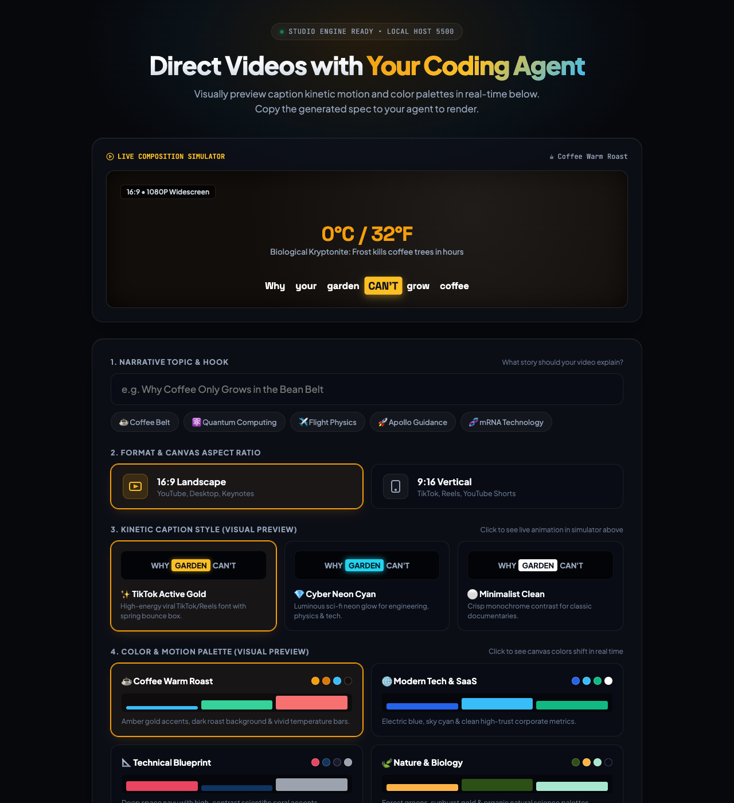
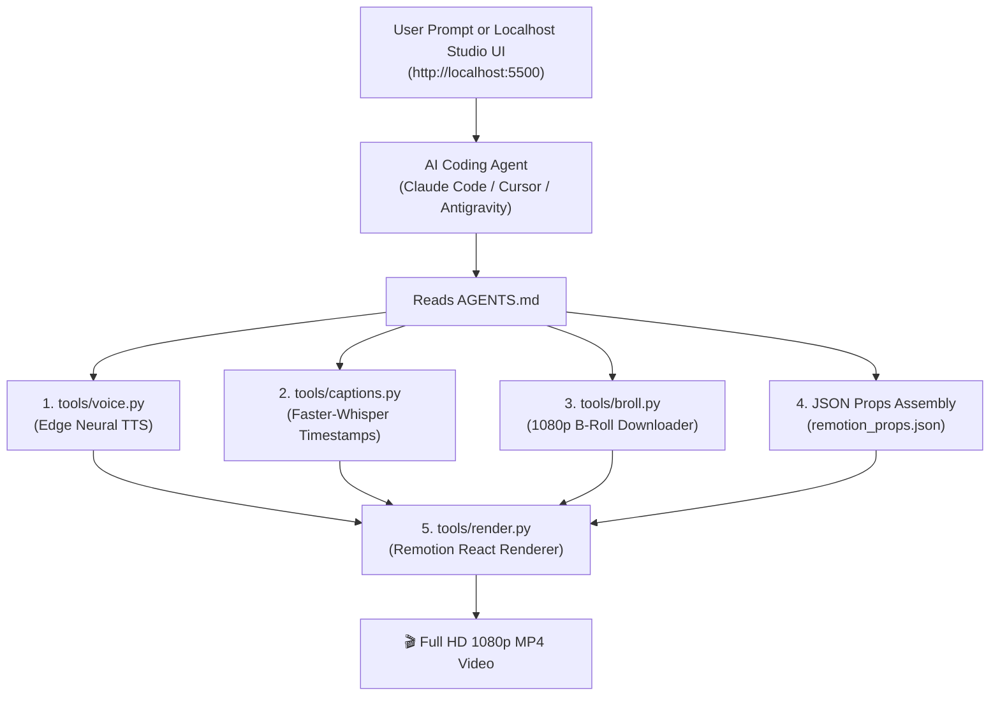

<div align="center">

# 🎬 Agent Video Studio

**The Open-Source Motion Graphics Video Studio Powered by Your AI Coding Agent.**<br>
Zero API keys. 100% Free. Natural Neural Voices + Whisper Word Captions + 1080p B-Roll + Remotion Motion Graphics.

[](LICENSE)
[](https://remotion.dev)
[](https://python.org)
[](#features)

<p align="center">
  <a href="#-quick-start-in-3-steps">Quick Start</a> &nbsp;·&nbsp;
  <a href="#-the-copy-pastable-agent-prompt">Copy-Pastable Prompts</a> &nbsp;·&nbsp;
  <a href="#-features">Features</a> &nbsp;·&nbsp;
  <a href="#-how-it-works">How It Works</a> &nbsp;·&nbsp;
  <a href="AGENTS.md">Agent Manual</a>
</p>

</div>

---

## 🌟 What is Agent Video Studio?

**Agent Video Studio** turns any AI coding agent (**Claude Code, Cursor, Antigravity, Windsurf, Copilot**) into a full-scale video production director.

Instead of paying \$50–\$200/month for ElevenLabs, stock footage subscriptions, or video editing software, this repo provides a **100% free, local production stack**:
- 🎙️ **Studio-Quality Voiceover:** Microsoft Edge Neural Voice (unlimited, zero API keys, expressive cadence).
- ✨ **Kinetic Active-Word Captions:** OpenAI Whisper extracts millisecond word timings; Remotion highlights words live with spring bounce physics.
- 🎥 **Real 1080p Stock Footage:** Topic-accurate B-roll layered beneath animated charts with cinematic contrast scrims.
- 📊 **Code-Driven Motion Graphics:** Animated multi-bar charts, stat reveal badges, and kinetic typography.
- 🖥️ **Zero-Dependency Localhost UI:** Choose voices, aspect ratios (16:9 or 9:16), themes, and topics in a dark-mode browser interface.

---

## 🚀 Quick Start in 2 Minutes

### 1. Clone & Install Dependencies
```bash
git clone https://github.com/n3owise/agent-video-studio.git
cd agent-video-studio

# Install Python audio & video tools
pip install -r requirements.txt

# Install Remotion motion graphics engine
cd remotion-composer && npm install && cd ..
```

### 2. Launch the Localhost Studio UI (Recommended)
Launch the interactive web control center:
```bash
python studio.py
```
Open **`http://localhost:5500`** in your browser!

<p align="center">
  
</p>

#### In the Localhost UI:
- **Live Visual Simulator:** See live caption animations and theme color palettes change in real-time as you click.
- **Aspect Ratio:** Toggle between **16:9 Landscape** (YouTube) and **9:16 Vertical** (TikTok / Reels / Shorts).
- **Neural Voice & Style:** Pick expressive neural voices (Andrew, Aria, Brian, Emma) and kinetic caption highlight styles.
- **1-Click Generation:** Click **`[ 🚀 Generate & Render Full HD Video Now ]`**. The backend will automatically write the script, synthesize audio, align captions, fetch B-roll, and render your Full HD MP4 with a live progress bar!
- **Instant Playback & Download:** Once finished, the video automatically loads in the browser player ready to watch and download.

---

### 3. Or Direct with Your AI Agent (Cursor / Claude Code / Antigravity)
If you prefer directing through chat with your AI agent, open the repo in Cursor, Claude Code, or Antigravity and paste:

```text
Please read AGENTS.md. I want to create a 60-second broadcast-quality explainer video on:
"Why Coffee Only Grows in the Bean Belt"

Please:
1. Write a 6-scene script (~135 words) with a hook, data obstacles, and a philosophical outro.
2. Generate natural voiceover with tools/voice.py using voice "en-US-AndrewMultilingualNeural".
3. Extract millisecond word captions with tools/captions.py.
4. Curate 1080p stock B-roll footage for each scene with tools/broll.py.
5. Assemble remotion_props.json with data charts, stat cards, and video layers.
6. Render the final Full HD MP4 video with tools/render.py.
```
*(Or simply tell your agent: **"Launch studio.py on localhost"** to open the visual UI!)*

---

## 🏗️ Architecture & Pipeline



---

## 💎 How It Compares to Commercial AI Video Generators

| Feature | Commercial Tools (ElevenLabs, HeyGen, InVideo) | Agent Video Studio (This Repo) |
| :--- | :--- | :--- |
| **Monthly Subscription** | \$30 – \$200 / month | **\$0 (Free & Open Source)** |
| **API Keys Required** | Yes (OpenAI, ElevenLabs, Pexels) | **Zero API Keys Required** |
| **Voiceover Quality** | Realistic | **Realistic Neural Voice (`edge-tts`)** |
| **Subtitle Quality** | Basic timed lines | **Millisecond Active-Word Spring Highlight** |
| **Motion Graphics** | Generic stock templates | **Custom React Code, SVG Charts & Spring Physics** |
| **Privacy & Storage** | Cloud hosted | **100% Local on your machine** |

---

## 📁 Repository Structure

```text
agent-video-studio/
├── README.md                      # You are here
├── AGENTS.md                      # The master instructions for AI coding agents
├── CLAUDE.md                      # Shortcuts for Claude Code
├── studio.py                      # Localhost UI control panel (http://localhost:5500)
├── requirements.txt               # edge-tts, faster-whisper, yt-dlp
│
├── tools/                         # Turnkey CLI tools the AI agent runs
│   ├── voice.py                   # Generates natural neural audio
│   ├── captions.py                # Extracts millisecond word timestamps
│   ├── broll.py                   # Downloads & normalizes 1080p stock footage
│   └── render.py                  # Executes Remotion Full HD render
│
├── remotion-composer/             # The React motion graphics studio
│   ├── src/Explainer.tsx          # Master composition with B-roll & data layers
│   ├── src/components/            # HeroTitle, StatCard, BarChart, CaptionOverlay
│   └── src/Root.tsx               # Theme configs (spring stiffness, palette)
│
├── examples/coffee-belt/          # Complete reference explainer project
│   ├── script.txt                 # Reference 135-word narration script
│   └── remotion_props.json        # Reference composition props
└── renders/                       # Output folder for your finished .mp4 videos
```

---

## 📄 License

This project is licensed under the [MIT License](LICENSE) — free for personal, commercial, and educational use.
